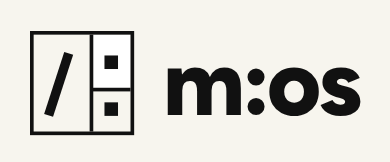

<div align="center">
  

  # MindrianOS

  **Talk to Larry. The room writes itself.**

  **For founders stuck on a decision they can't name.**

  A thinking partner that sits on top of your AI. You talk through a problem. Larry finds the real problem before you solve the wrong one, brings the right method at the right moment, pushes back when your confidence runs ahead of your evidence, and files the conversation into a folder on your own machine that is still there next time.

  [](LICENSE)
  [](#three-surfaces)

  [Website](https://mindrian-os.com) &middot;
  [Marketplace](https://github.com/jsagir/mindrian-marketplace) &middot;
  [Changelog](CHANGELOG.md)
</div>

---

## The job you hire it for

You have a Problem worth Solving (PwS): a venture, a research question, a decision you cannot get right alone. You are probably about to solve the wrong version of it.

MindrianOS is hired to fix that, in this order:

1. **Find the real problem.** Larry's first move is usually a question that reframes what you walked in with.
2. **Bring the right method, at the right time.** Not a list of frameworks. The one that fits your problem, and the order to use it in.
3. **Keep you honest.** When you are sure and the evidence is thin, Larry says so. A raw AI will help you build a beautiful deck on a false premise. Larry will not.
4. **Remember.** Every decision, rejection and meeting lands in a room that is waiting for you next session.

It is not a note-taker and it is not a chatbot. It is the layer that makes your AI remember, judge, and hold you to your own reasoning.

---

## How it works

1. **You talk.** Whatever is in your room (the venture, the decision, the meeting you just filed) becomes context.
2. **Larry asks the Brain.** The Brain is a methodology graph that knows WHEN to use WHICH method, and in WHAT sequence. Only a generic question goes out, such as a framework name or a type of problem.
3. **Larry joins the answer to your situation.** Your problem, run through real methodology, not a lecture.
4. **You decide.** Approve, reject with a reason, or defer. Your call becomes part of the room.
5. **The room remembers.** Next time it checks today's input against everything you decided before.

When the Brain has nothing structured for your question, Larry says so plainly and queues the gap. He never improvises methodology. A session with no Brain key or no connection gets the same honest refusal and a visible way forward. It never gets a quiet imitation of an answer.

---

## Install

You need Node.js 22.18.0 or newer and a Claude plan that can use plugins.

```bash
claude plugin marketplace add jsagir/mindrian-marketplace
claude plugin install mos@mindrian-marketplace
```

Restart Claude Code. Larry starts talking. The Brain is part of what installs: your install registers itself quietly in the background, so there is no key to paste and no account to make first. If you already have a Brain key, it wins and nothing changes.

Prefer one command? `npx @mindrian_os/cli` does the same job. The full walkthrough is in the [install guide](https://mindrian-os.com/docs/install).

**Quick start**

```text
/mos:ignite        # start a room, or pick up where you left off
```

Then talk. Larry reaches for the right command for you.

**Update.** Third-party plugins do not update on their own, so run both lines:

```bash
/plugin marketplace update                      # refreshes the catalog
claude plugin update mos@mindrian-marketplace   # installs the latest version
```

Something feels off? Run `/mos:doctor`. From a normal terminal, `mindrian-os doctor` does the same check.

---

## What you get

- **A room on your machine.** A structured folder (default `~/MindrianRooms/`) that holds your venture, decisions and files. It is yours.
- **Larry, a teaching partner.** He asks before he tells, and he marks when an answer came from the Brain and when it is just conversation.
- **Methods that fit.** Reframing a problem, running discovery, grading an idea against real ventures, mapping the weakest assumption in your plan.
- **Claims you can trust.** A claim counts as confirmed only after it was checked against a source. Ask `/mos:status --checks` for the plain picture of your whole room.
- **Research you approve.** `/mos:research` shows you every search before it is sent, runs only after you say yes, and files findings only when you say yes. A failed search never reads as "nothing found".
- **Connections you did not ask about.** When your room changes in a way that matters, MindrianOS looks for links across your material and brings back at most one card, only when it holds up.
- **Eureka, cross-domain opportunity finding.** See below.

### Eureka: where ideas from different fields meet

Most good opportunities sit between two fields that never talk to each other. `/mos:eureka` recalls pairs of ideas from different domains in your own room, plans the research for them, and files the pairs that survive your review as proposed opportunities. `/mos:eureka-portfolio` ranks the linked ideas in your room and tells you when the ranking moves.

Be clear about what it needs. Eureka runs on an optional engine that is set up separately from the plugin, and the ranking uses an optional measuring tool on your machine (`/mos:eureka enable` installs it). On a bare install it tells you what is missing instead of guessing. It also needs a room with ideas from more than one area to work on.

---

## Three surfaces

Same Larry, same room, wherever Claude works.

| Surface | What it gives you |
|---------|-------------------|
| **Claude Code CLI** | Full power. Hooks fire, scripts run, the room is on disk, Larry teaches with visible structure. |
| **Claude Desktop** | Conversation first. Your room shows up as inline panels (dashboard, wiki, knowledge graph). Connector setup is in [`docs/install/BRAIN-SETUP.md`](docs/install/BRAIN-SETUP.md). |
| **Cowork** | Same plugin, shared room. Daily briefings, persistent perspectives, more than one person. |

---

## Your room stays on your machine

This is the promise, and it is a rule in the project's constitution ([`docs/MINDRIAN-CANON.md`](docs/MINDRIAN-CANON.md), Part 8):

- **Your room never goes to the Brain.** Your notes, decisions and meetings stay local.
- **Only generic methodology crosses.** A framework name or a type of problem goes out. Methodology comes back.
- **Search stays home.** The embeddings that power semantic search are made on your machine, with no network egress.
- **The only per-install thing the Brain sees** is a random 32-character identifier, minted once and stored locally. It tells the Brain one install from another. It does not tell the Brain who you are. See [`docs/THEO-INSTALL-ID.md`](docs/THEO-INSTALL-ID.md).

MindrianOS writes only to your rooms (default `~/MindrianRooms/`) and to session state (`./.mindrian/`).

---

## The three layers

| Layer | What it is | Who owns it |
|-------|-----------|-------------|
| **Plugin** | The skills, commands, agents and hooks that run the conversation | Open, in this repo |
| **Brain** | Theo, the methodology graph, served over MCP (the standard way Claude reaches an outside service) | Served remotely, never distributed |
| **Room** | Your venture, your decisions, your files | You, on your machine |

Theo is the Brain's current engine and runs at `theo-mcp.onrender.com`. You never talk to it directly; Larry does, for you. A live census dated 2026-10-01 counts 28,131 nodes and 457 frameworks in the graph ([census](docs/BRAIN-GRAPH-CENSUS.generated.md)). More: [`docs/THE-BRAIN.md`](docs/THE-BRAIN.md).

---

## Optional extras

Neither of these is needed to start. They are separate things, so keep them apart.

- **Your own room graph on Neo4j Aura.** If you want your room's graph in a database you own, you can point it at your own Aura instance (the free tier is enough). It is your data on your instance.
- **A manual Brain key.** The silent registration is the default. A manual key is the override for an operator identity, a paid tier, or troubleshooting. Request one at [mindrian-os.com/brain-access](https://mindrian-os.com/brain-access), then follow [`docs/install/BRAIN-SETUP.md`](docs/install/BRAIN-SETUP.md).

---

## Commands are shortcuts

Talk. That is the interface. These are here for when you already know what you want:

```text
/mos:ignite               # the front door: start or resume a room
/mos:discover             # client, product and jobs-to-be-done discovery
/mos:beautiful-question   # reframe the problem before solving it
/mos:file-meeting         # paste a transcript, Larry files it
/mos:graph "what is the weakest assumption in my financial model?"
/mos:grade                # an honest assessment against real ventures
/mos:research             # planned, gated research you approve first
/mos:status --checks      # the plain-words state of your room
```

This is a slice of what ships: 113 commands, 126 skills, 17 agents and 4 pipelines, with hooks on 12 session events. If you do not know which one to run, that is normal. Just talk.

---

## Permissions

Claude Code asks you to approve each shell command as it runs. Choose "always allow" on the ones you are happy with. For granular control, copy the matcher set from [`docs/settings-template.json`](docs/settings-template.json) into `~/.claude/settings.json`. The read and write surface is bounded to your workspace and your rooms.

---

## Links

- **Website:** [mindrian-os.com](https://mindrian-os.com)
- **Install guide:** [mindrian-os.com/docs/install](https://mindrian-os.com/docs/install)
- **Marketplace:** [github.com/jsagir/mindrian-marketplace](https://github.com/jsagir/mindrian-marketplace)
- **Changelog:** [CHANGELOG.md](CHANGELOG.md)
- **The Brain:** [docs/THE-BRAIN.md](docs/THE-BRAIN.md), [docs/install/BRAIN-SETUP.md](docs/install/BRAIN-SETUP.md)

---

## License

Source-available under BSL 1.1. Copyright Jonathan Sagir and PwS / Mindrian.

This is a source-available license. It is not an open source license.
