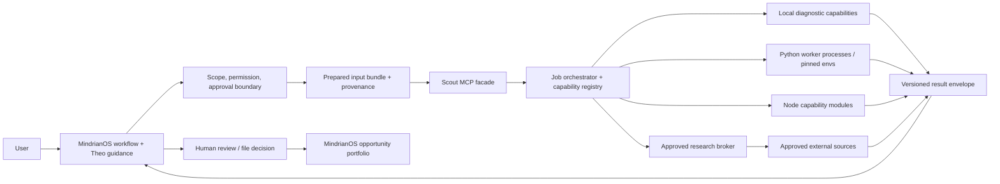

# Mindrian Opportunity Scout: standalone repository architecture

**Status:** architecture proposal for review  
**Purpose:** define an independently buildable repository that MindrianOS can call for opportunity discovery across local room material and explicitly approved research.  
**Scope:** system and repository architecture. No repository has been initialized and no engine code has been migrated.

## 1. Decision summary

Create a standalone repository named **`mindrian-eureka`**. The MindrianOS-facing workflow is named **`/m:os:eureka`**. The repo owns reusable opportunity-discovery capabilities and bounded job execution. MindrianOS remains the user-facing host and the source of truth for room permissions, approval gates, room data, and opportunity decisions.

The standalone repo should provide:

1. A **unified MCP-facing service** for MindrianOS to start and inspect scout jobs.
2. A **capability registry** describing what each method does, when to hire it, required inputs, dependencies, egress, maturity, and output.
3. A **job orchestrator** that selects or runs explicitly requested capability sequences and preserves state.
4. **Engine adapters and isolated workers** for reviewed methods. Python, Node, embedding, and network methods run behind versioned worker contracts.
5. Shared **input, result, provenance, and failure contracts** so MindrianOS can present results consistently.
6. Optional remote worker support only after the local contract and permission path are established.

Start as **one local MCP server with internal capability modules and bounded worker processes**. Keep module boundaries strong enough that an engine can later become a separate MCP server without changing MindrianOS's user-level workflow. Do not launch one MCP server per engine merely because there are multiple engine folders.

## 2. System boundary and ownership

| Responsibility | MindrianOS host | Opportunity Scout repo |
|---|---|---|
| User conversation, room/session binding | Owns | No direct ownership |
| User objective, scope, exclusions | Presents and records user choices | Validates the scoped request and identifies missing inputs |
| Room access and permissions | Owns authorization; supplies a bounded input manifest/bundle | Reads only the supplied/authorized inputs; cannot guess a room or expand scope |
| External research approval | Owns user gate and grants | Executes only through the approved research broker; no engine-owned credentials or unrestricted fetch |
| Framework guidance / Theo | Host obtains guidance and supplies authorized case context | Executes only the selected bounded method; returns monitorable stage artifacts |
| Engine methods and environments | Calls capabilities | Owns capability metadata, adapters, runtimes, job status, logs, results |
| Portfolio source of truth | Owns portfolio record, cross-room policy, review/disposition | Returns candidate proposals; never confirms or commits them |
| Truth/decision status | Human user and MindrianOS gates own promotion | Labels generated claims as hypotheses/proposals and preserves uncertainty |
| Remote execution | Defines consent and permitted data transfer | Runs only an explicit, minimized job capsule with expiry and return provenance |

**Key rule:** the Scout repo may return a candidate batch, but cannot write directly to MindrianOS room files, room graph, or canonical portfolio. MindrianOS validates results and asks the user before filing or changing truth/disposition state.

## 3. Architecture



### Execution modes

- **Local call:** MindrianOS starts the Scout MCP server as a local stdio process. It passes a scoped run request; the Scout returns a durable job handle and result references.
- **Local worker:** orchestrator invokes a capability in-process only when it is trusted, small, and easy to interrupt; otherwise it starts a bounded child process.
- **Remote job (later):** MindrianOS sends a minimized, approved research capsule to a remote endpoint. This is a distinct data boundary and requires explicit user policy, authentication, retention/deletion controls, and audit events.

MCP is the host/capability interface. It is not the process sandbox, durable queue, database, user-approval system, or model provider. The official MCP model distinguishes tools, resources, and prompts; use them for callable actions, application-provided context, and user-selected workflows respectively. [MCP server primitives](https://modelcontextprotocol.io/specification/draft/server/index)

## 4. Capability model and user-facing names

The registry exposes jobs by user need, not by historical folder names. Names below are working names; final JTBD copy belongs in the capability manifest.

| Capability ID | User-facing name | Job | Initial status |
|---|---|---|---|
| `bottleneck.diagnose` | **Find the Bottleneck** | Find which subsystem or missing input most constrains a stated objective. | Existing MindrianOS RS route; compare contract before reuse. |
| `coverage.find_gaps` | **Find Portfolio Gaps** | Locate under-covered themes or evidence areas in a scoped corpus. | Experimental; HSI implementation/reducer behavior needs resolution. |
| `opportunity.find_pairs` | **Find Breakthrough Pairs** | Produce a bounded candidate set of potentially valuable item pairs. | Current Eureka perspective differs from retired legacy runner; use current route as baseline. |
| `analogy.find_mechanisms` | **Find Mechanisms from Other Fields** | Retrieve or recall candidate mechanisms relevant to a problem. | Experimental; distinguish local recall from approved external retrieval. |
| `analogy.map_structure` | **Test a Structural Analogy** | Map a selected source mechanism to a target problem and expose candidate inferences. | SME mapping prototype; candidate inference is not validation. |
| `claims.compare` | **Compare Competing Explanations** | Compare two explicit explanations/claims using defined criteria. | Jason prototype; calibration and contract required. |
| `deliberation.structure` | **Structure a Decision Debate** | Organize multiple perspectives and a human ruling for a bounded what-if. | Use existing MindrianOS BONO initially; package copy is unreviewed. |
| `evidence.fetch_for_question` | **Gather Evidence for a Question** | Fetch evidence for an approved question or bottleneck thesis. | Must route through approved broker; package-specific fetchers disabled until audited. |
| `experts.find_for_topic` | **Find Relevant Experts** | Identify relevant experts from available, authorized research records. | Blocked until required transport, privacy behavior, and data prerequisites are established. |
| `thesis.read_prior` | **Read a Prior Bottleneck Thesis** | Retrieve and explain a saved RS thesis. | Readback only; not a discovery run. |

The “Algorithms” folder contains three distinct concepts (Genesis, Jason, Opposable Mind HMM); they must not be advertised as one executable. Opposable Mind remains a research method until it has an executable implementation, inputs, outputs, and validation.

## 5. Engine and worker architecture

Every capability implements a common interface, while retaining method-specific payloads:

```ts
interface Capability<I, O> {
  manifest: CapabilityManifest;
  validate(input: I): ValidationResult;
  run(input: I, ctx: RunContext): Promise<CapabilityResult<O>>;
}
```

Worker protocol is versioned JSON over stdin/stdout initially. Stdout carries only protocol messages; diagnostics go to stderr. The orchestrator owns timeout, cancellation, environment variables, file access, network policy, and retry/idempotency. A worker cannot write to the portfolio or declare its own egress audit as authoritative.

### Runtime policy

- TypeScript/Node control plane because MindrianOS is Node-based and existing MOS adapters are CommonJS. Keep protocol boundaries language-neutral.
- Python methods use separately pinned virtual environments; build a container only when native dependencies, trust isolation, reproducibility, or resource quotas justify it. Python virtual environments isolate project dependencies; containers add another isolation boundary but do not guarantee data confinement. [Python packaging guide](https://packaging.python.org/en/latest/guides/installing-using-pip-and-virtual-environments/) · [Docker Engine security](https://docs.docker.com/engine/security/)
- The process environment is allowlisted; no broad inheritance of API keys or home-directory access.
- Local analysis defaults to network-denied. External research is a separate capability that receives only an approved query grant.
- Input is read-only by default. Workers receive only the files or records listed in the run manifest.
- Return `failed`, `partial`, `blocked`, `cancelled`, and `completed_empty` distinctly. Missing models or dependency failures can never masquerade as “no opportunity.”
- Resource limits are explicit: wall-clock timeout, memory/CPU budget, maximum input size, maximum candidate count, search budget, and retry cap.

Docker describes container namespaces and cgroups for process/resource isolation, while also warning about incomplete isolation under some configurations. Therefore, network and data policies must be enforced by the host/runner and not inferred from containerization alone. [Docker Engine security](https://docs.docker.com/engine/security/)

## 6. Core contracts

### Capability manifest

Each capability ships a machine-readable manifest:

```yaml
id: analogy.map_structure
name: Test a Structural Analogy
jtbd: "When I have a specific source mechanism and target problem, test whether their relationships map."
status: experimental # enabled | experimental | blocked | retired
input_schema: schemas/analogy-map-input.v1.json
output_schema: schemas/analogy-map-output.v1.json
runtime: python-sme
network: denied
data_classes: [user-provided-derived-structure]
requires: [source_structure, target_structure]
side_effects: []
limitations: ["Mapping produces candidate inferences, not verified facts."]
evaluation: evals/analogy-map/
```

Manifest must also carry version, source/license provenance, dependency lock hash, resource bounds, supported OS/architecture, determinism expectations, input size limits, and a deprecation path.

### Run request

```json
{
  "schema_version": "scout.run.v1",
  "job_id": "caller-generated-idempotency-key",
  "capability_id": "bottleneck.diagnose",
  "objective": { "text": "...", "desired_decision": "...", "constraints": [] },
  "scope": {
    "scope_id": "opaque-host-reference",
    "snapshot_id": "sha256:...",
    "artifacts": [{ "id": "opaque-source-id", "sha256": "...", "media_type": "text/markdown" }]
  },
  "policy": {
    "network": "denied",
    "model_route": "none",
    "max_runtime_seconds": 120,
    "max_candidates": 25
  },
  "follow_up_of": null
}
```

The actual content is provided through a scoped local input bundle or a host-managed resolver, not arbitrary absolute paths supplied by the model. A `scope_id` is not authorization on its own; the host/adapter validates it against current room permissions.

### Result envelope

```json
{
  "schema_version": "scout.result.v1",
  "job_id": "...",
  "capability_id": "bottleneck.diagnose",
  "capability_version": "...",
  "status": "completed",
  "runner": {
    "artifact_digest": "sha256:...",
    "runtime": "python 3.x",
    "dependency_lock_digest": "sha256:...",
    "model_provider": null,
    "started_at": "...",
    "finished_at": "...",
    "exit_code": 0
  },
  "scope": { "snapshot_id": "sha256:...", "read_artifact_ids": ["..."] },
  "egress": { "events": [], "authoritative_source": "runner" },
  "outputs": [{ "id": "candidate-...", "kind": "bottleneck_hypothesis", "payload": {}, "source_refs": ["..."] }],
  "limitations": [],
  "warnings": [],
  "resource_use": { "duration_ms": 0, "tokens": null, "estimated_cost": null },
  "failure": null
}
```

Runner-generated records are authoritative for input hashes, runtime, egress, exit status, timeout, and retries. The engine supplies its method result, evidence references, and method-specific uncertainty. The host validates the envelope before showing or filing any result.

## 7. MCP surface

Expose a small user/workflow surface. Keep low-level engine invocation and run-control operations available to the MindrianOS orchestrator but do not force users to learn internal package names.

Initial MCP tools:

- `scout_capabilities` — list enabled/experimental/blocked capabilities with JTBD and prerequisites.
- `scout_plan` — transform objective + authorized scope into a proposed sequence and explain why; no execution or egress.
- `scout_start` — start one approved plan; returns durable `job_id`.
- `scout_status` — inspect progress, partial results, blockers, and required user action.
- `scout_result` — retrieve a validated result envelope by job ID.
- `scout_cancel` — cancel a running job and prevent later stages from starting.
- `scout_evidence_plan` — prepare exact research queries for host approval; does not fetch.
- `scout_evidence_run` — execute only with a host-issued, scoped grant.

Potential MCP resources: `scout://capabilities`, `scout://jobs/{job_id}`, `scout://runs/{job_id}/manifest`. Potential prompts: `scout-opportunity`, `scout-bottleneck`, and `scout-deep-dive`. Prompts support user-selected entry points; MCP tools do the work; resources provide inspectable state.

MindrianOS should own presentation and approvals. Even when the Scout server supports the MCP protocol, no tool annotation is treated as an authorization control; runtime code validates grants and input scope.

## 8. Persistence, recovery, and portfolio boundary

The standalone repo needs **job persistence**, not a competing opportunity portfolio.

- Local development/first release: SQLite job ledger plus immutable run artifacts under a configurable data directory.
- Job states: `planned`, `awaiting_host_approval`, `queued`, `running`, `partial`, `completed`, `completed_empty`, `blocked`, `failed`, `cancelled`, `expired`.
- Persist job request hash, capability/version, snapshot ID, status transitions, checkpoints, bounded logs, result envelope, and timestamps.
- Idempotency key prevents duplicate external fetch or charges on retry.
- Resume from checkpoints only when inputs, capability version, policy, and grant remain valid.
- Grants expire and are revalidated at each outbound stage. Revocation stops not-yet-started outbound steps.
- MindrianOS stores canonical opportunity records and decisions. Scout results are proposals with opaque source refs; host resolves refs only when authorized.
- Room deletion/revocation must invalidate job access and remove derived artifacts according to an explicit retention policy.

## 9. Theo, ICM, and MindrianOS relationship

**MindrianOS is the product host.** It binds the user and room, applies the user’s privacy rules, invokes Theo/framework tools, translates selected criteria into a plan, and provides the only route to portfolio writes.

**Theo is the framework director/reviewer at the workflow layer.** The host supplies bounded stage inputs/results and asks Theo to select or apply a framework and identify gaps. The standalone runtime should not secretly call Theo or assume it can read Theo context. If Theo is later connected as a capability provider, that is declared in the manifest with model/egress details.

**ICM is the auditable run structure, not the runtime.** The standalone job engine can emit stage artifacts that an ICM workflow records/reviews. The scheduler, retries, locks, worker lifecycle, permission checks, and durable job state belong to software in the standalone repo or host.

The relationship:

```text
MindrianOS user workflow + room authority
   ├─ asks Theo for framework/review guidance
   ├─ creates scoped run request
   ├─ calls Scout MCP
   ├─ monitors Scout job and presents artifacts through ICM-style stages
   └─ validates and files user-approved portfolio decisions
                  ▲
                  │ MCP contracts and result envelopes
                  ▼
Standalone Opportunity Scout runtime
   ├─ capability registry and plan/job lifecycle
   ├─ local and Python/Node engine workers
   ├─ approved research broker
   └─ durable run artifacts; no canonical portfolio writes
```

## 10. Repository layout

```text
mindrian-eureka/
├── README.md
├── LICENSE
├── SECURITY.md
├── CONTRIBUTING.md
├── CHANGELOG.md
├── package.json
├── package-lock.json
├── tsconfig.json
├── uv.lock / per-worker lock files
├── docs/
│   ├── architecture.md
│   ├── threat-model.md
│   ├── capability-catalog.md
│   ├── integrations/mindrianos.md
│   ├── decisions/ADR-*.md
│   └── operations/
├── schemas/
│   ├── capability-manifest.v1.json
│   ├── run-request.v1.json
│   └── run-result.v1.json
├── src/
│   ├── mcp/                 # public MindrianOS-facing server
│   ├── api/                 # contracts, validators, error taxonomy
│   ├── registry/            # capability manifests, status and routing
│   ├── orchestration/       # plans, jobs, state machine, cancellation
│   ├── policy/              # scope/grant validation; default-deny network
│   ├── provenance/           # snapshot hashes, run/evidence lineage
│   ├── persistence/          # local job ledger and artifact store
│   ├── workers/              # process manager, limits, IPC, redaction
│   ├── research-broker/      # outbound connector interface, no direct engine fetch
│   └── integrations/mindrianos/
├── capabilities/
│   ├── bottleneck-diagnose/
│   ├── portfolio-gap-finder/
│   ├── breakthrough-pair-scout/
│   ├── cross-field-mechanism-finder/
│   ├── structural-analogy-mapper/
│   ├── differential-claim-critic/
│   └── deliberation-structure/
├── workers/
│   ├── python-common/
│   ├── hsi/
│   ├── rs/
│   ├── sme/
│   └── algorithms/
├── evals/
│   ├── capability-contracts/
│   ├── routing/
│   ├── provenance/
│   └── end-to-end/
├── fixtures/                # synthetic/public data only
└── scripts/
    ├── dev-server
    ├── doctor
    └── package-worker
```

Do not copy engine folders wholesale into this repository. First record original source, author, license, modified files, third-party dependencies, and the right to redistribute. Migrate each capability only after its manifest, input/output contract, side effects, and evaluation case are understood.

## 11. Security and privacy model

### Data classes

Treat these as distinct classes, not a single “room data” flag:

1. local file content;
2. extracted spans/summaries;
3. embeddings and derived structures;
4. user objective and constraints;
5. external search query;
6. source response and citation metadata;
7. model prompts/outputs;
8. telemetry and logs.

Every capability declares which classes it reads, writes, and sends. “Runs locally” describes compute placement only; it does not imply local model inference or zero egress.

### Default-deny controls

- No network from analysis workers unless the orchestrator assigns a research-broker grant.
- No room-wide paths supplied by a model. Host resolves `scope_id` to a bounded manifest.
- No credentials inherited by child processes unless a broker token is explicitly scoped to one job/provider/action.
- No worker writes to room or portfolio data.
- No query fan-out without per-job count, time, and cost budgets.
- Do not execute engine code from unreviewed source in a user's room.
- Retention and deletion apply to inputs, vectors, caches, logs, external-source data, and derived candidates.
- Prompt-injection content in source artifacts is data, never authority to change scope, permissions, or tool calls.

Threat-model review must include malicious input documents, path traversal, symlink escapes, stale grants, retries after partial success, secret leakage in stdout/stderr, dependency supply-chain compromise, model prompt injection, and unauthorized cross-room reads.

## 12. Evaluation strategy

Every capability needs its own contract evaluation and the system needs end-to-end evaluation.

- **Contract evaluation:** valid/invalid inputs, status semantics, schema, provenance completeness, determinism where promised, and failure behavior.
- **Isolation/permission evaluation:** network denied by default; approval and revocation; path/scope enforcement; secret allowlist; resource limits; cancel/retry correctness.
- **Method evaluation:** domain-specific baseline and known limitations. A score is only used for the purpose it was calibrated for.
- **Routing evaluation:** whether the selected capability matches the user job and available evidence; compare with user/analyst routing.
- **User independence evaluation:** can a user start, understand, recover, review, and file a result without developer intervention?
- **Portfolio evaluation:** source traceability, candidate uniqueness, decision usefulness, review time, stale-result handling, and reasons for park/reject.

Keep usability and discovery quality as separate experiments. Define the baseline, scope, scoring rubric, reviewer procedure, and thresholds before each evaluation. Do not use candidate count or engine count as the success metric.

## 13. Build sequence and exit criteria

### Phase 0 — Repository and license readiness

- Create the standalone git repository and establish license/security/contribution policy.
- Resolve source provenance and redistribution rights for each candidate engine.
- Freeze the first supported runtime and host protocol versions.

**Exit:** repo builds an empty MCP service; source/licensing ledger exists; no engine code imported without provenance.

### Phase 1 — Contracts and local runtime shell

- Implement manifest, run request/result schemas, error taxonomy, job state machine, SQLite ledger, artifact store, and worker IPC.
- Implement `scout_capabilities`, `scout_plan`, `scout_start`, `scout_status`, `scout_result`, and `scout_cancel` with a synthetic capability.
- Enforce local scope and default-deny network.

**Exit:** synthetic jobs persist across restart, are idempotent/cancellable, return clear failure states, and cannot access undeclared inputs or network.

### Phase 2 — MindrianOS adapter

- Add a thin adapter in MindrianOS that passes scoped manifests and host-issued grants.
- Keep room selection, Theo workflow, user approval, and portfolio writes in MindrianOS.
- Validate returned result envelopes before display/filing.

**Exit:** a user can inspect scope, start a job, recover its status after restart, and review a proposed result without manual filesystem or command-line handling.

### Phase 3 — First real capability

Choose one capability only after comparing current MindrianOS implementation with package source. Strong candidates are local bottleneck diagnosis or gap finding, depending on which has the cleanest contract and least hidden egress. Keep the method's known limitations visible.

**Exit:** capability passes contract/isolation evaluations and improves completion or decision usefulness over a documented baseline without reducing provenance.

### Phase 4 — Selected engine migration

Add one capability at a time. Require license/provenance, input/output contract, runtime profile, known limitations, an evaluation fixture, and failure states before enabling it. Do not promote all research-bundle engines together.

### Phase 5 — Approved evidence broker

Integrate exact-query planning, grants, fetches, source capture, cost/budget tracking, and egress audit. Disable direct network in every engine worker.

**Exit:** request-level audit agrees with actual network activity; revoked/expired grants stop future outbound calls; offline mode sends nothing.

### Phase 6 — Remote/paid worker (optional)

Add only after local execution and lifecycle are proven. Require per-job capsules, tenant isolation, authentication, destination-bound approvals, retention/deletion, observability, and restart recovery.

**Exit:** independent security review and explicit data owner approval for each enabled data class and provider.

## 14. Architecture choices to keep open

| Decision | Initial choice | Revisit when |
|---|---|---|
| MCP topology | One local MCP server; internal capabilities; stable contracts | A method has a distinct trust/credential/deployment boundary or independent release needs. |
| Worker language | Node/TypeScript control plane; Python subprocess workers where required | Engine maturity or distribution evidence justifies a different core. |
| Persistence | Local SQLite job ledger + run artifacts | Concurrent multi-user remote service needs a managed database/queue. |
| Input transfer | Host-authorized manifest and bounded local bundle | Payload size/performance requires a local scoped resolver protocol. |
| Portfolio data | MindrianOS owns it | Never move canonical portfolio authority into Scout without a product-level migration decision. |
| Theo | Host-mediated framework plan/review | A reviewed, approved Theo artifact-access integration exists. |
| Containers | Optional per worker | Native dependencies, untrusted code, or resource isolation requires them. |

## 15. Immediate design decisions for repo kickoff

1. Confirm repo name and remote location.
2. Choose whether initial delivery is **MindrianOS-only local MCP** or a reusable local CLI + MCP server. Recommendation: ship both entry points over the same core API so capability contracts can be exercised without the host.
3. Decide source/license policy before copying any research engine code.
4. Ratify the ownership boundary: Scout proposes; MindrianOS owns user permissions, canonical portfolio, and truth-state transitions.
5. Select one first capability only after a current-vs-package implementation audit.

